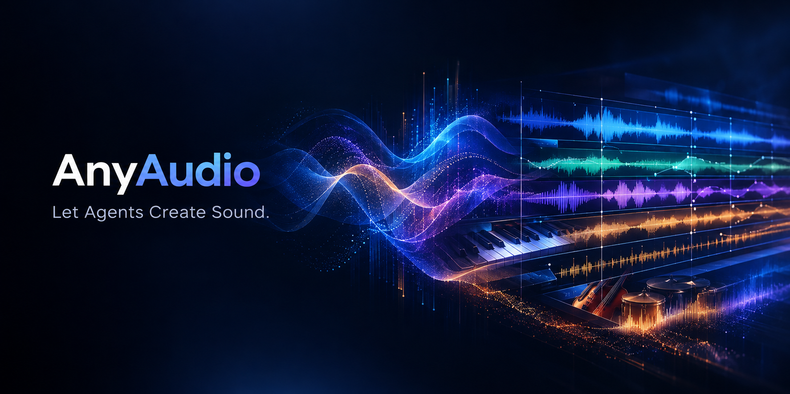

<div align="center">



# AnyAudio

**Let Agents Create Sound.**

An agent-driven audio production toolkit for music, sound effects, narration, and mixing.

<p><b>Music · Sound Effects · Narration · Mixing</b><br>
<sub>让 Agent 做出真正的声音。</sub></p>

[](https://github.com/cloudoyx/any-audio/blob/main/LICENSE)
[](https://nodejs.org)
[](#install)
[](#known-limitations)

[Hear the difference](#hear-the-difference) · [Install](#install) · [Sound sources](#sound-sources) · [Speech TTS](#speech-tts) · [中文说明](https://github.com/cloudoyx/any-audio/blob/main/README.zh-CN.md)

</div>

---

AnyAudio is an audio production toolkit for AI agents. It turns a sound idea into an actual audio project: write notes and render real instruments, write lines and generate speech, drop in sound effects, arrange the structure, and mix the multitrack result. Video soundtracks are just one use — scenes, sound design, standalone music, audiobooks, podcasts and game audio all come out of the same pipeline.

The agent keeps the creative decisions. AnyAudio supplies the tools and execution needed to turn a sound idea into a finished audio file.

## What it solves

Models can already write code that makes sound, but it rarely sounds like an instrument, a recording, or a finished mix. AnyAudio fills that gap:

- **Real instrument timbres** — rendered from local sample banks instead of hand-written oscillators.
- **Notes land directly on the timeline** — millisecond accuracy; music, narration and effects share one clock.
- **Automatic mix balance** — tracks are placed in order with per-track gain, pan and fades; declaring a track as `narration` makes the plugin duck the other buses under the voice, and the master is peak-normalised so the whole mix does not clip.
- **Effects and voices** — sound effects either sampled from the installed banks or generated procedurally, plus speech through Edge TTS and MiMo-V2.5-TTS (currently free).

## Hear the difference

Both pairs contain identical material: one version made without the plugin, one with it. Listen first, read the numbers after.

> GitHub plays embedded videos muted by default — click the speaker icon in the player to hear the audio.

### "Fly Me to the Moon", bossa nova: arranged and adapted by the agent

The same 57-second bossa nova. Version A was produced the way an agent works without AnyAudio, writing NumPy synthesis directly; version B was rendered by AnyAudio from local sample banks. Same arrangement, only the sound source changed.

| | Version A — without AnyAudio | Version B — with AnyAudio |
| --- | --- | --- |
| Peak / average level | -1.5 dBFS / -19.9 dB | -1.5 dBFS / -20.8 dB |
| Crest factor | 18.4 dB | 19.3 dB |
| Spectral centroid | 1,356 Hz | 1,890 Hz |
| Energy above 4 kHz | 6.8% | 11.6% |

<table><tr><td width="50%" valign="top"><sub>Music version A — waveform and spectrogram</sub></td><td width="50%" valign="top"><sub>Music version B — waveform and spectrogram</sub></td></tr><tr><td>https://github.com/user-attachments/assets/9f496f67-0bd7-496e-96d9-4c2ccb4a28eb</td><td>https://github.com/user-attachments/assets/86ac18e0-f530-452b-9711-7f7471855b80</td></tr></table>

Version B uses sampled instruments: it sounds more like real players, with more high-frequency detail and more dynamic headroom.

### A rainy night in five lines: speech and sound effects

The same 24-second scene, five lines of dialogue, plus rain, footsteps and a door, produced twice. Lines and timing are identical.

| | Version A — without AnyAudio | Version B — with AnyAudio |
| --- | --- | --- |
| Peak / average level | -1.5 dBFS / -27.5 dB | -1.5 dBFS / -26.1 dB |
| Crest factor | 26.0 dB | 24.6 dB |
| Spectral centroid | 5,629 Hz | 4,401 Hz |
| Energy above 4 kHz | 55.3% | 44.0% |

<table><tr><td width="50%" valign="top"><sub>Speech and effects version A — waveform and spectrogram</sub></td><td width="50%" valign="top"><sub>Speech and effects version B — waveform and spectrogram</sub></td></tr><tr><td>https://github.com/user-attachments/assets/c4ae1a17-d7bc-4db1-b96a-be244fd75358</td><td>https://github.com/user-attachments/assets/4fca1c9e-b373-4ab7-b18b-afe3e81ad102</td></tr></table>

Version B's voices match the emotion and pacing of the scene more closely, and its effects are more realistic and more detailed.

## Install

Node.js 22.19+ (22.x) or 24+ (bundled with DSH); ffmpeg is only needed for speech and for muxing video.

```bash
dsh plugin --profile desktop add dsh-any-audio
```

If DSH boots a different profile, replace `desktop` with that profile name. Restart DSH once after installing so it picks up the plugin.

Then open the **AnyAudio** page in DSH Settings to install a sound source (GeneralUser GS is the default suggestion), switch the speech engine and adjust mixing defaults. No SoundFont is bundled with the package.

### From source

For local development, install from a clone instead of the registry:

```bash
git clone https://github.com/cloudoyx/any-audio.git
cd any-audio
npm install && npm run font
dsh plugin --profile desktop add "<absolute path to the cloned folder>"
```

The path must be absolute (on Windows, `D:/any-audio` style), and DSH needs a restart once after adding it. `npm run font` downloads both suggested banks (about 72 MB) into the shared sound library, which is handy when you want the banks ready before opening Settings.

## Quick start

Describe the work as usual while generating a video; the agent calls the plugin to render audio on its own:

> Make a 30-second ink-wash animation: a seed in a rock crevice grows into a sapling. Add a little Chinese-style music and wind, no narration.

You can adjust musical detail and mixing behaviour as you go:

> Guzheng lead, strings bed, cello on the low end; pull the music down whenever a voice comes in.

For a song, state the brief and call it directly:

> Write me a Japanese RPG battle theme, loopable, 30 to 60 seconds. Drums, electric guitar and strings.

You can even build an audiobook from scratch:

> Turn Chapter 1 of Romance of the Three Kingdoms into an audiobook — deep, rich narration, distinguishable character voices, with simple background music and effects.

## Sound sources

The repository does not bundle SoundFonts. The plugin offers two **suggested** banks — GeneralUser GS as the default foundation and MuseScore General as an extra general-purpose orchestral bank — and it can also load compatible SoundFont files (`.sf2`, `.sf3`, `.dls`) placed in `~/.dsh/anyaudio/fonts`. That directory is one shared library for every project and agent session on the machine, so a bank installed once is available everywhere.

| Bank | Size | License | How to get it | Notes |
| --- | --- | --- | --- | --- |
| GeneralUser GS | 32 MB | GeneralUser GS License v2.0 | One click | **Suggested — default foundation and fallback**; the only bank guaranteed to include a drum kit |
| MuseScore General | 40 MB | MIT | One click | **Suggested — extra general-purpose orchestral bank**; 309 presets, fuller strings and ensembles |
| Upright Piano KW | 27 MB (7z) | CC0 1.0 | Manual | Single-instrument piano bank, used on piano tracks only |
| Electric Guitar Clean | 446 MB (unpacked) | CC0 1.0 | Manual | Single-instrument electric guitar bank |

Installing both suggested banks gives the widest coverage: GeneralUser GS stays the default, while MuseScore General joins the automatic ranking for orchestral families. Download links and extraction notes for the last two are in Settings and in [THIRD_PARTY_NOTICES.md](https://github.com/cloudoyx/any-audio/blob/main/THIRD_PARTY_NOTICES.md); keep the file names unchanged after extracting so the plugin can recognise them.

## Speech TTS

Two engines, one interface:

| Engine | Key | Notes |
| --- | --- | --- |
| **Edge TTS** (default) | Not required | Free, through Microsoft's public endpoint; needs ffmpeg to convert MP3 to WAV; may be rate-limited, in which case the plugin retries and reports a clear error. |
| **MiMo-V2.5-TTS** (optional) | Normal Open Platform API key | More voices and styles; the key is stored in DSH credentials and only read on the host side. Currently free; register your own API key. |

MiMo is opt-in: saving a key does not switch the default engine, you choose it explicitly. The default voice `mimo_default` is resolved by the service cluster and may differ between regions. This version supports normal Open Platform keys only.

## Known limitations

- **SoundFont only** — no SFZ, Kontakt or VST; converting other source formats is out of scope for this version.
- **No per-note envelope control** — attack and release come from the preset; use short notes with gaps for staccato and velocity plus expression for dynamics.
- **Chinese instruments are GM approximations** — `guzheng` maps to Koto, `dizi` to Flute, `erhu` to Fiddle; dedicated banks will do better.

## Support the project

AnyAudio is an independent open-source project. If it helps your work or your creation, you are welcome to buy me a coffee to support further development.

Any amount is appreciated.

<div align="center">
  
  <p>WeChat Pay</p>
</div>

## License

Code is MIT, see [LICENSE](https://github.com/cloudoyx/any-audio/blob/main/LICENSE).

SoundFonts and third-party components keep their own licenses, see [THIRD_PARTY_NOTICES.md](https://github.com/cloudoyx/any-audio/blob/main/THIRD_PARTY_NOTICES.md). This repository distributes no sample banks.
