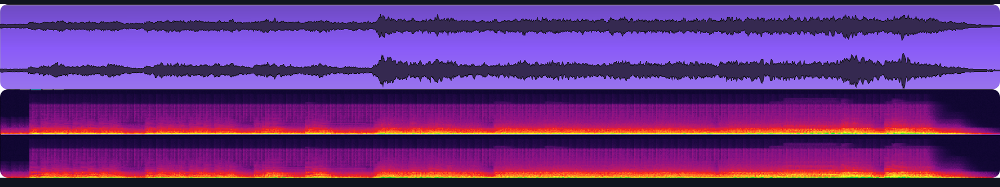
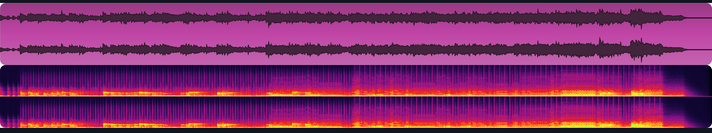
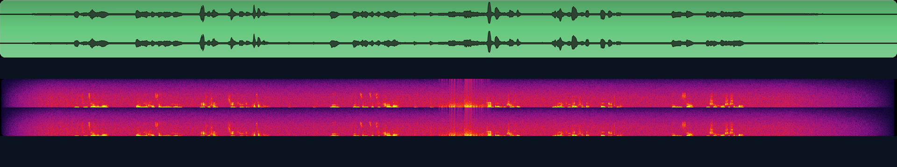
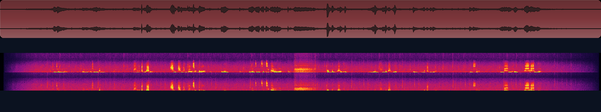
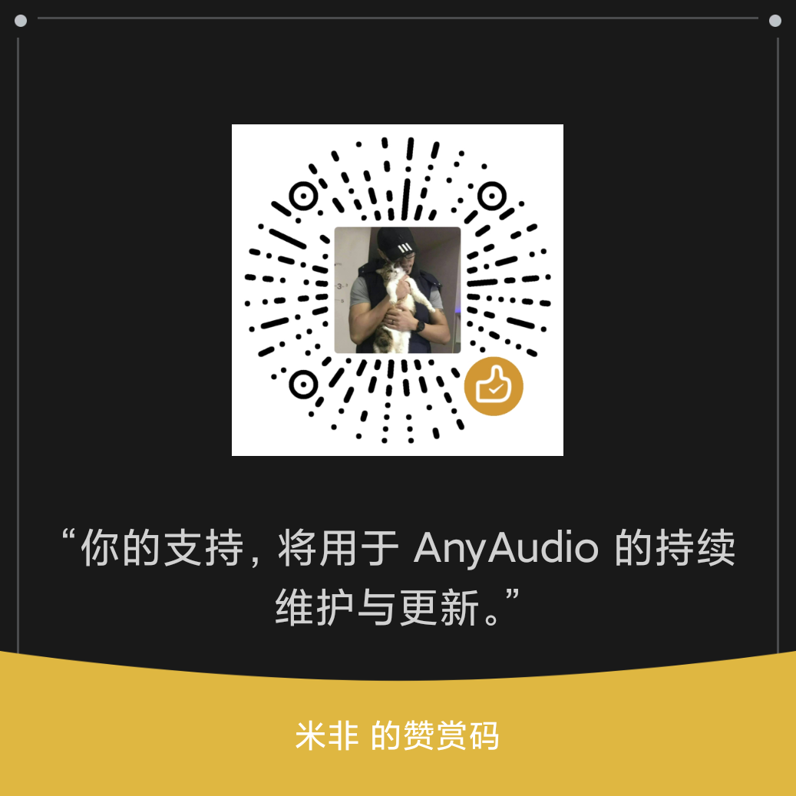

<div align="center">

# AnyAudio

**让 Agent 做出真正的声音。**

An agent-driven audio production toolkit for music, sound effects, narration, and mixing.

一套由 Agent 驱动的音频制作工具，涵盖音乐、音效、配音与混音，让 Agent 具备音频制作能力。

[](LICENSE)
[](https://nodejs.org)
[](#安装)
[](#已知限制)

[先听为快](#先听为快) · [安装](#安装) · [音源](#音源) · [语音-tts](#语音-tts) · [English](README.md)

</div>

---

AnyAudio 是面向 AI Agent 的音频制作工具。它把"声音创意"翻译成可执行的音频工程：写音符并渲染真实乐器、写台词并生成高质量语音、注入音效并编排结构、完成多轨混音。视频配乐、场景音效、独立音乐、有声书、播客、游戏音效，全部都可以用它做出来。

Agent 负责创意与编排，AnyAudio 提供将声音创意转化为实际音频作品所需的工具与执行能力。

## 它解决什么问题

模型已经能写代码合成声音，但很难让它听起来像乐器、像录音、像成品。AnyAudio 补的是这一段：

- **真实乐器音色**：用本地音源采样渲染，而不是手写振荡器。
- **音符直接落在时间轴上**：精确到毫秒，音乐、旁白、音效共用同一个时钟。
- **混音自动平衡**：按顺序放置多轨，支持每轨增益、声像与淡入淡出；把某轨标为 `narration` 时，插件会在人声出现时自动下压其它总线；母带做峰值归一，整体不会削波。
- **音效与配音**：音效既可取自已安装音源的采样，也可程序化合成；语音支持 Edge TTS 与 MiMo-V2.5-TTS（官方免费中）。

## 先听为快

两组素材内容完全相同，一组不用插件、一组用插件。建议先听，再看数字。

> GitHub 默认静音播放内嵌视频，请点一下播放器右下角的喇叭图标开启声音。

### 《Fly Me to the Moon》bossa nova 版：Agent 自行编曲改编

同一段 57 秒的 bossa nova。A 版不使用 AnyAudio，由模型直接写 NumPy 合成；B 版由 AnyAudio 用本地音源渲染。编曲相同，只换声音来源。

| | A 版 — 不用 AnyAudio | B 版 — 用 AnyAudio |
| --- | --- | --- |
| 峰值 / 平均电平 | -1.5 dBFS / -19.9 dB | -1.5 dBFS / -20.8 dB |
| 波峰因数 | 18.4 dB | 19.3 dB |
| 频谱质心 | 1,356 Hz | 1,890 Hz |
| 4 kHz 以上能量 | 6.8% | 11.6% |

<table><tr><td width="50%" valign="top"><sub>音乐 A 版 — 波形与频谱图</sub></td><td width="50%" valign="top"><sub>音乐 B 版 — 波形与频谱图</sub></td></tr><tr><td>https://github.com/user-attachments/assets/9f496f67-0bd7-496e-96d9-4c2ccb4a28eb</td><td>https://github.com/user-attachments/assets/86ac18e0-f530-452b-9711-7f7471855b80</td></tr></table>

B 版使用音源素材，声音更真实，高频细节更多、动态余量更大。

### 五句对白的雨夜场景：语音与音效

同一个 24 秒场景，五句对白，加上雨声、脚步声、开门声，做两遍。台词和时间完全一样。

| | A 版 — 不用 AnyAudio | B 版 — 用 AnyAudio |
| --- | --- | --- |
| 峰值 / 平均电平 | -1.5 dBFS / -27.5 dB | -1.5 dBFS / -26.1 dB |
| 波峰因数 | 26.0 dB | 24.6 dB |
| 频谱质心 | 5,629 Hz | 4,401 Hz |
| 4 kHz 以上能量 | 55.3% | 44.0% |

<table><tr><td width="50%" valign="top"><sub>语音与音效 A 版 — 波形与频谱图</sub></td><td width="50%" valign="top"><sub>语音与音效 B 版 — 波形与频谱图</sub></td></tr><tr><td>https://github.com/user-attachments/assets/c4ae1a17-d7bc-4db1-b96a-be244fd75358</td><td>https://github.com/user-attachments/assets/4fca1c9e-b373-4ab7-b18b-afe3e81ad102</td></tr></table>

B 版人声情绪和节奏更贴合场景，音效更真实，细节更多。

## 安装

需要 Node.js 22.19+（22.x）或 24+（DSH 运行时自带）；ffmpeg 只在生成语音和封装视频时需要。

```bash
git clone https://github.com/cloudoyx/any-audio.git
cd any-audio
npm install && npm run font
dsh plugin --profile desktop add "<克隆目录的绝对路径>"
```

路径要写绝对路径（Windows 上形如 `D:/any-audio`）。如果 DSH 启动的不是 `desktop` profile，把 `desktop` 换成实际使用的 profile 名。`npm run font` 会把两套建议音源（约 72 MB）下载进共享音源库。

装好后 DSH 设置里会出现 **AnyAudio** 页面，用来安装音源、切换语音引擎和调整混音默认值。如果没出现，重启一次 DSH。

## 快速开始

生成视频时像平时一样提需求，Agent 会自己调用插件进行音频渲染：

> 做一个 30 秒的水墨动画：石缝里的一粒种子长成树苗。配一点中国风音乐和风声，不要旁白。

可以随着调整音乐细节和混音逻辑：

> 古筝主旋律，弦乐铺底，大提琴走低音；人声出现时把音乐压下去。

想写歌时说清楚需求，直接调用：

> 帮我写一首日式 RPG 的战斗曲目，可无限循环，30 秒到 60 秒。乐器用鼓组 + 电吉他 + 弦乐。

你甚至可以从零开始制作有声小说：

> 帮我把《三国演义》第一章做成有声小说，旁白低沉浑厚，角色音色要有所区分，配一些简单的配乐和音效即可。

## 音源

仓库不打包 SoundFont。插件提供两套**建议安装**的音源——GeneralUser GS 作为默认基础音源，MuseScore General 作为额外的通用管弦乐音源——也支持加载放入 `~/.dsh/anyaudio/fonts` 的兼容 SoundFont 音源（`.sf2`、`.sf3`、`.dls`）。该目录是整台机器共用的音源库，所有项目与 Agent 会话共用同一份，装过一次即可处处可用。

| 音源 | 体积 | 许可证 | 获取方式 | 说明 |
| --- | --- | --- | --- | --- |
| GeneralUser GS | 32 MB | GeneralUser GS License v2.0 | 一键 | **建议安装 — 默认基础音源与兜底**；唯一保证带鼓组的音源 |
| MuseScore General | 40 MB | MIT | 一键 | **建议安装 — 额外的通用管弦乐音源**；309 个预设，弦乐与合奏更完整 |
| Upright Piano KW | 27 MB（7z） | CC0 1.0 | 手动 | 单乐器钢琴库，只用于钢琴轨 |
| Electric Guitar Clean | 446 MB（解压后） | CC0 1.0 | 手动 | 单乐器电吉他库 |

两套都装覆盖最广：GeneralUser GS 仍是默认音源，MuseScore General 参与管弦乐族的自动选择。后两套的下载地址与解压说明在设置页和 [THIRD_PARTY_NOTICES.md](THIRD_PARTY_NOTICES.md)；解压后保持文件名不变，插件才能识别。

## 语音 TTS

两个引擎，一个接口：

| 引擎 | Key | 说明 |
| --- | --- | --- |
| **Edge TTS**（默认） | 不需要 | 免费，走 Microsoft 公共接口；需要 ffmpeg 把 MP3 转成 WAV；可能被限流，插件会重试并给出明确错误。 |
| **MiMo-V2.5-TTS**（可选） | 普通 Open Platform API Key | 音色与风格更多；Key 存在 DSH 凭据里，只在宿主侧读取。官方免费中，可自行注册 API Key。 |

MiMo 是手动选项：保存 Key 不会自动切换默认引擎，要显式选择。默认音色 `mimo_default` 由服务端集群决定，不同区域可能不同。本版本只支持普通 Open Platform Key。

## 已知限制

- **只支持 SoundFont**：不支持 SFZ、Kontakt、VST；转换其它音源格式不在本版范围。
- **没有逐音符包络控制**：发音与释放由预设决定；断奏用短音符加缝隙，强弱用力度与表情控制。
- **中国乐器是 GM 近似**：`guzheng` 映射 Koto、`dizi` 映射 Flute、`erhu` 映射 Fiddle；专用音源会更好。

## 支持项目

AnyAudio 是一个独立开源项目。如果它对你的工作或创作有所帮助，欢迎请我喝杯咖啡，支持后续开发。

无论金额多少，都感谢你的支持。

<div align="center">
  
  <p>微信支付</p>
</div>

## 许可证

代码采用 MIT，见 [LICENSE](LICENSE)。

SoundFont 与第三方组件沿用各自许可证，见 [THIRD_PARTY_NOTICES.md](THIRD_PARTY_NOTICES.md)。本仓库不分发任何音源库。
