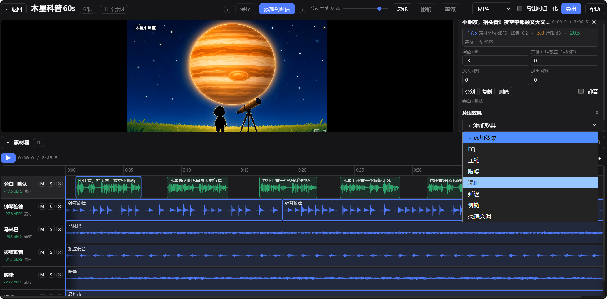
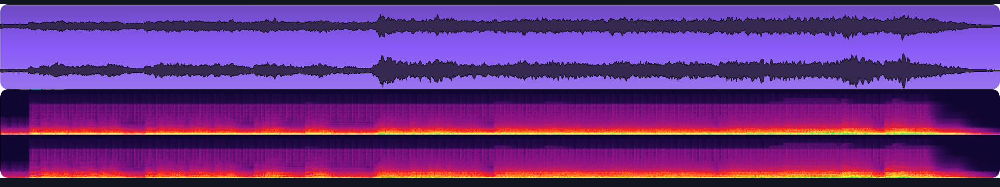
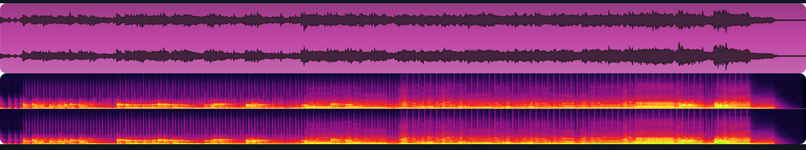
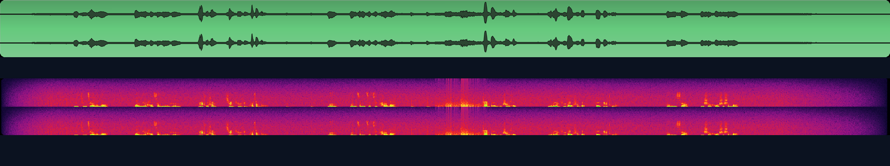
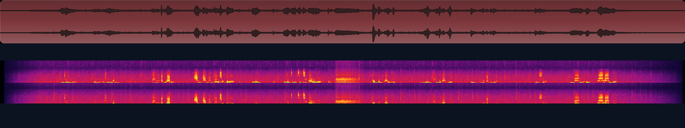
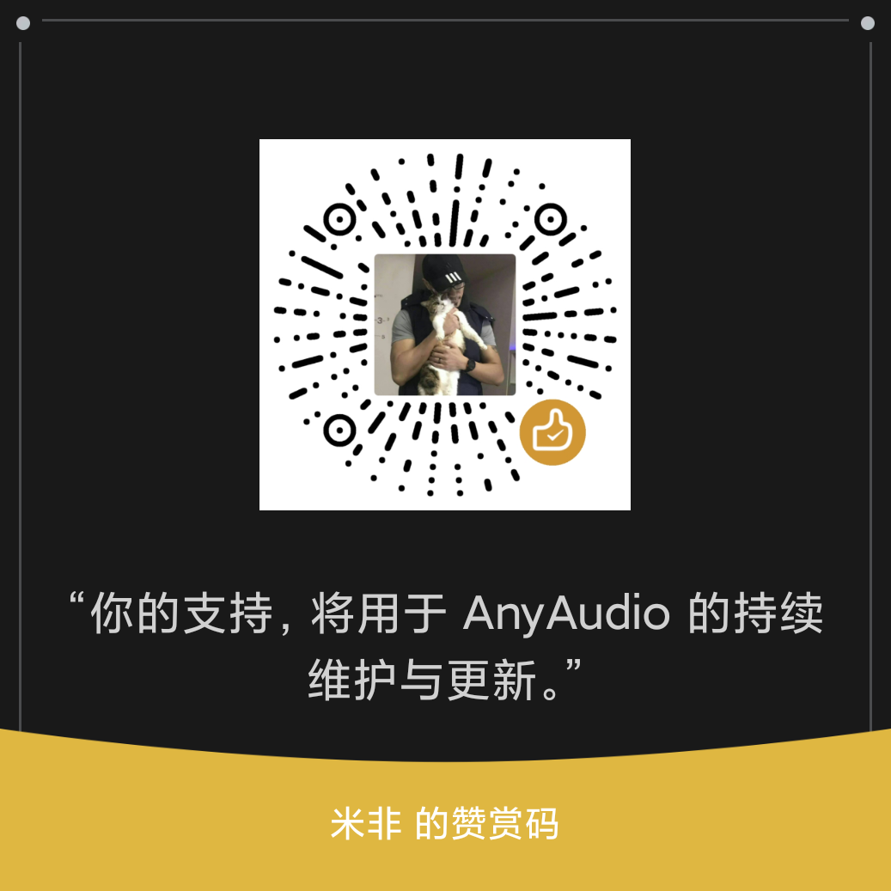

<div align="center">

# AnyAudio

**让 Agent 做出真正的声音。**

An agent-driven audio production toolkit for music, sound effects, narration, and mixing.

一套由 Agent 驱动的音频制作工具，涵盖音乐、音效、配音与混音，让 Agent 具备音频制作能力。

[](https://github.com/cloudoyx/any-audio/blob/main/LICENSE)
[](https://nodejs.org)
[](#安装)
[](#已知限制)

[先听为快](#先听为快) · [剪辑台](#剪辑台) · [安装](#安装) · [音源](#音源) · [语音-tts](#语音-tts) · [唱歌](#唱歌) · [English](https://github.com/cloudoyx/any-audio/blob/main/README.md)

</div>

---

AnyAudio 是面向 AI Agent 的音频制作工具。它把"声音创意"翻译成可执行的音频工程：写音符并渲染真实乐器、写台词并生成高质量语音、注入音效并编排结构、完成多轨混音，再进剪辑台逐轨试听和精调。视频配乐、场景音效、独立音乐、有声书、播客、游戏音效，全部都可以用它做出来。

Agent 负责创意与编排，AnyAudio 提供将声音创意转化为实际音频作品所需的工具与执行能力。

<div align="center">
  
  <sub>剪辑台里的一个真实工程：旁白、钟琴、马林巴、拨弦低音、暖垫、轻打击各占一轨，六轨十一段素材，语音与音乐共用同一条时间轴</sub>
</div>

## 它解决什么问题

模型已经能写代码合成声音，但很难让它听起来像乐器、像录音、像成品。AnyAudio 补的是这一段：

- **真实乐器音色**：用本地音源采样渲染，而不是手写振荡器。
- **音符直接落在时间轴上**：精确到毫秒，音乐、旁白、音效共用同一个时钟。
- **混音自动平衡**：按顺序放置多轨，支持每轨增益、声像与淡入淡出；把某轨标为 `narration` 时，插件会在人声出现时自动下压其它总线；母带做峰值归一，整体不会削波。调完可以逐段试听，不满意再改。
- **音效与配音**：音效优先取自已安装的音效库（一包真实录音，按名字检索），库里没有再去线上找 CC0，最后才用音源采样或程序化合成；语音支持 Edge TTS、MiMo-V2.5-TTS（官方免费中）与 DeepSeek TTS（用本机 DSH 登录的账号）。
- **唱歌**：给 Agent 音符和歌词，它在本机合成人声，作为单独一轨进剪辑台；提出歌曲/演唱需求时 Agent 自动调用唱歌工具。

## 先听为快

两组素材内容完全相同，一组不用插件、一组用插件。建议先听，再看数字。

> GitHub 默认静音播放内嵌视频，请点一下播放器右下角的喇叭图标开启声音。

### 《Fly Me to the Moon》bossa nova 版：Agent 自行编曲改编

同一段 57 秒的 bossa nova。A 版不使用 AnyAudio，由模型直接写 NumPy 合成；B 版由 AnyAudio 用本地音源渲染。编曲相同，只换声音来源。

| | A 版 — 不用 AnyAudio | B 版 — 用 AnyAudio |
| --- | --- | --- |
| 峰值 / 平均电平 | -1.5 dBFS / -19.9 dB | -1.5 dBFS / -20.8 dB |
| 波峰因数 | 18.4 dB | 19.3 dB |
| 频谱质心 | 1,356 Hz | 1,890 Hz |
| 4 kHz 以上能量 | 6.8% | 11.6% |

<table><tr><td width="50%" valign="top"><sub>音乐 A 版 — 波形与频谱图</sub></td><td width="50%" valign="top"><sub>音乐 B 版 — 波形与频谱图</sub></td></tr><tr><td>https://github.com/user-attachments/assets/9f496f67-0bd7-496e-96d9-4c2ccb4a28eb</td><td>https://github.com/user-attachments/assets/86ac18e0-f530-452b-9711-7f7471855b80</td></tr></table>

B 版使用音源素材，声音更真实，高频细节更多、动态余量更大。

### 五句对白的雨夜场景：语音与音效

同一个 24 秒场景，五句对白，加上雨声、脚步声、开门声，做两遍。台词和时间完全一样。

| | A 版 — 不用 AnyAudio | B 版 — 用 AnyAudio |
| --- | --- | --- |
| 峰值 / 平均电平 | -1.5 dBFS / -27.5 dB | -1.5 dBFS / -26.1 dB |
| 波峰因数 | 26.0 dB | 24.6 dB |
| 频谱质心 | 5,629 Hz | 4,401 Hz |
| 4 kHz 以上能量 | 55.3% | 44.0% |

<table><tr><td width="50%" valign="top"><sub>语音与音效 A 版 — 波形与频谱图</sub></td><td width="50%" valign="top"><sub>语音与音效 B 版 — 波形与频谱图</sub></td></tr><tr><td>https://github.com/user-attachments/assets/c4ae1a17-d7bc-4db1-b96a-be244fd75358</td><td>https://github.com/user-attachments/assets/4fca1c9e-b373-4ab7-b18b-afe3e81ad102</td></tr></table>

B 版人声情绪和节奏更贴合场景，音效更真实，细节更多。

## 剪辑台

一个可视化工作台。Agent 生成的音乐、配音、音效落进来之后，你能看到每一轨的波形，拖动位置、调音量、加淡入淡出、逐段试听。

传统 DAW 是给人用的，AI 只是辅助。这个剪辑台反过来：**Agent 负责生成和批量调整，人负责给 Agent 下指令，也可以亲自试听并精调。** 某句台词晚了半秒、某个音效盖住了人声，亲手改比重新生成一遍快得多。

人和 Agent 在同一条时间轴上协作：选中一段点「添加到对话」，那段就变成一句引用，在它后面写你要怎么改，Agent 就知道你说的是哪儿；反过来也可以先自己调一个片段当样板，试听满意了，再让 Agent 照这个批量改其他片段。

## 安装

需要 Node.js 22.19+（22.x）或 24+（DSH 运行时自带）；ffmpeg 只在生成语音和封装视频时需要。

```bash
dsh plugin --profile desktop add dsh-any-audio
```

如果 DSH 启动的不是 `desktop` profile，把 `desktop` 换成实际使用的 profile 名。装完重启一次 DSH，它才会加载这个插件。

第一次装好插件后，打开一个新对话会看到六步引导：欢迎、装音源、装音效包、选配音引擎、装唱歌引擎、认识剪辑台。每一步都能跳过，也可以稍后在「设置 → AnyAudio → 高级」里点「重新播放引导」再看一遍。

安装包不带任何声音资源，第一次使用时按需下载安装。默认推荐：

- 音源用 GeneralUser GS（通用乐器，约 32 MB）
- 音效包用 BaseSFX（237 条真实录音，约 161 MB）
- TTS 引擎用 Edge（也可选 MiMo-TTS，现阶段免费）
- 唱歌声库用绮萱（甜美女声，约 401 MB）

## 快速开始

生成视频时像平时一样提需求，Agent 会自己调用插件进行音频渲染：

> 做一个 30 秒的水墨动画：石缝里的一粒种子长成树苗。配一点中国风音乐和风声，不要旁白。

可以随着调整音乐细节和混音逻辑：

> 古筝主旋律，弦乐铺底，大提琴走低音；人声出现时把音乐压下去。

想写歌时说清楚需求，直接调用：

> 帮我写一首日式 RPG 的战斗曲目，可无限循环，30 秒到 60 秒。乐器用鼓组 + 电吉他 + 弦乐。

也可以让它把词唱出来：

> 用绮萱把《青花瓷》副歌"天青色等烟雨"几句唱出来。

你甚至可以从零开始制作有声小说：

> 帮我把《三国演义》第一章做成有声小说，旁白低沉浑厚，角色音色要有所区分，配一些简单的配乐和音效即可。

做完之后打开顶部的**剪辑台**，声音已经按轨摆好了：

> 把第三句台词往后挪半秒，再把整条旁白轨降 2 dB。

## 音源

插件支持两类音源：**SoundFont**（`.sf2`、`.sf3`、`.dls`）和 **VST3 乐器插件**。SoundFont 体积小、安装简单；VST3 音色更真实、可调性更好。两类可以同时使用。

| 音源 | 体积 | 许可证 | 获取方式 | 说明 |
| --- | --- | --- | --- | --- |
| GeneralUser GS | 32 MB | GeneralUser GS License v2.0 | 一键 | **SoundFont — 建议安装，默认基础音源与兜底**；唯一保证带鼓组的音源 |
| MuseScore General | 40 MB | MIT | 手动 | **SoundFont — 建议安装，额外的通用管弦乐音源**；309 个预设，弦乐与合奏更完整 |
| Electric Guitar Clean | 446 MB（解压后） | CC0 1.0 | 手动 | SoundFont — 单乐器电吉他库 |
| Dexed | 8.9 MB | GPL-3.0 | 手动 | VST3 — FM 合成器，32 个音色 |
| Grand Piano (Audiolatry) | 6 MB | CC BY 3.0 | 手动 | VST3 — 单音色钢琴 |

仓库不打包任何音源。第一次用，先装默认的 GeneralUser GS 作为基础音源，然后根据自己的需要添加其他音源（也支持自定义音源）。

## 音效

音效取自已安装的音效库，库里没有时 Agent 会找线上 CC0，再没有才用音源采样或程序化合成。

| 音效包 | 条数 | 体积 | 获取方式 |
| --- | --- | --- | --- |
| BaseSFX | 237 | 161 MB | 手动下载、本地安装 |

在「设置 → AnyAudio → 音效」标签页或首次引导里下载压缩包，解压后把解压出来的 `BaseSFX` 目录完整路径填进「安装」即可。

## 语音 TTS

三个引擎，一个接口：

| 引擎 | Key | 说明 |
| --- | --- | --- |
| **Edge TTS**（默认） | 不需要 | 免费，走 Microsoft 公共接口；需要 ffmpeg 把 MP3 转成 WAV；可能被限流，插件会重试并给出明确错误。支持调语速、音高、音量。 |
| **MiMo-V2.5-TTS**（可选） | 普通 Open Platform API Key | 音色与风格更多；Key 存在 DSH 凭据里，只在宿主侧读取。官方免费中，可自行注册 API Key。语气用 `style` 描述。 |
| **DeepSeek TTS**（可选） | 不需要额外配置 | 用本机 DSH 登录的 DeepSeek 账号。只有两个音色（`stella` 女声、`tide` 男声），**不能调语速/音高/音量**；按字数计费，需账号有余额。 |

MiMo 与 DeepSeek 都是手动选项：保存 Key 或登录账号都不会自动切换默认引擎，要显式选择。MiMo 的默认音色 `mimo_default` 由服务端集群决定，不同区域可能不同，本版本只支持普通 Open Platform Key。DeepSeek 的 Key 就是 DSH 自己登录用的那一把，插件不会写入或删除它——删了会连带影响 DSH 的模型访问。

## 唱歌

唱歌工具按音符和歌词在本机合成真实人声，作为单独一条人声轨进剪辑台——能试听、调音量、逐句重生成。Agent 遇到唱歌需求时自动调用，无需点名工具。

### 安装唱歌环境

1. **第一步：装运行环境。** 打开「设置 → AnyAudio → 唱歌 → 安装唱歌环境」，装好运行环境和声码器。
2. **第二步：下载声库包。** 从 GitHub 或百度网盘、夸克网盘下载官方声库 zip，三处是同一个原包。
3. **第三步：安装声库。** 回到设置页，填入本地 zip 完整路径并安装。

npm 包里不带这些东西，首次使用需下载安装。

### 显卡加速（可选增强）

- 选显卡时会先确认，然后额外下载约 216 MB 的 `onnxruntime-gpu`（含 CUDA/cuDNN）。插件实测多个镜像选最快的一个。
- 下载期间仍按 CPU 运行，关掉设置页也不中断。
- 装好后「自动」和「显卡」都走显卡，「CPU」仍走 CPU。若显卡环境不兼容，重装唱歌环境即可恢复。

实测速度：3 分钟的歌，CPU 约 247 秒，显卡约 28.5 秒，快约 8.7 倍。

## 已知限制

- **工程规模上限**：单个工程最长 15 分钟、最多 20 轨，超出会直接报错。
- **这版只剪音频**：视频可以作为参考画面一起放进来，但画面上不做裁剪、拼接或转场。
- **轨道里必须是成品音频**：放在时间轴上的每一段都是已经渲染好的 wav/mp3，可以单独试听；MIDI、乐谱和参数不会直接进时间轴。
- **音源支持 SoundFont 与 VST3**：不支持 SFZ；Kontakt 等需要专用容器的音源不在支持范围。
- **没有逐音符包络控制**：发音与释放由预设决定；断奏用短音符加缝隙，强弱用力度与表情控制。
- **中国乐器是 GM 近似**：`guzheng` 映射 Koto、`dizi` 映射 Flute、`erhu` 映射 Fiddle；专用音源会更好。
- **唱歌音质由声库和调教决定**：插件只提供安装渠道、接口和使用方式。
- **唱歌只保证绮萱声库**基本可用；其它声库接口开放但不保证加载与效果，需自行调教排查。

## 支持项目

AnyAudio 是一个独立开源项目。如果它对你的工作或创作有所帮助，欢迎请我喝杯咖啡，支持后续开发。

无论金额多少，都感谢你的支持。

<div align="center">
  
  <p>微信支付</p>
</div>

## 许可证

代码采用 MIT，见 [LICENSE](https://github.com/cloudoyx/any-audio/blob/main/LICENSE)。

音源与第三方组件沿用各自许可证，见 [THIRD_PARTY_NOTICES.md](https://github.com/cloudoyx/any-audio/blob/main/THIRD_PARTY_NOTICES.md)。本仓库不分发任何音源库。